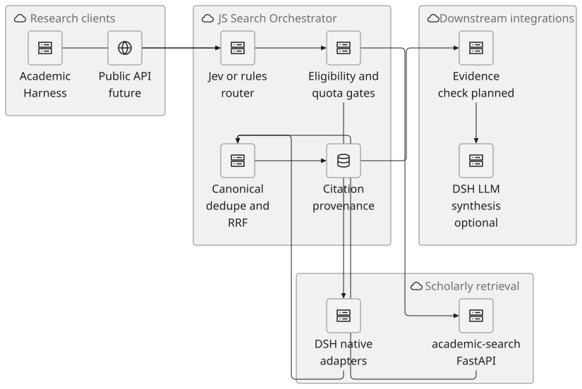
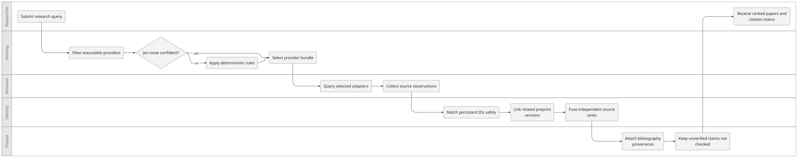
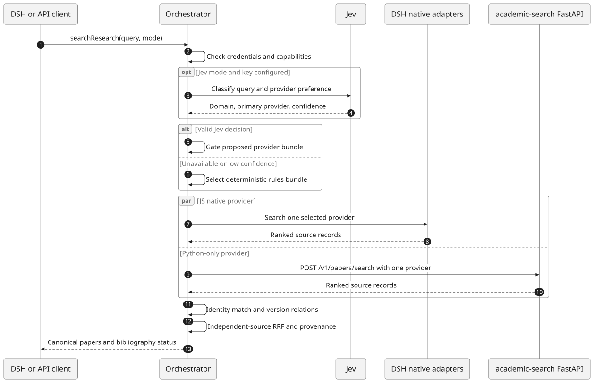
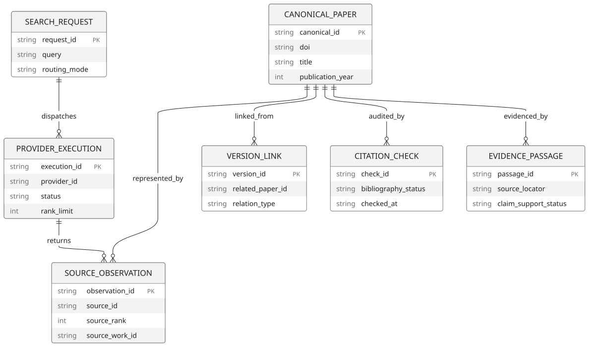

# Academic Search Orchestrator

**Jev-powered provider selection → independent scholarly searches → identity-aware deduplication → rank fusion → canonical evidence/citation contracts**, designed as a reusable package for [Academic Harness](https://github.com/raktim-mondol/academic-harness) (a DeepSeek Harness plugin) and [academic-search](https://github.com/raktim-mondol/academic-search) (Python SDK/API).

> **Scaffold, not a deployed service.** This repo includes working offline routing, matching, RRF, Python REST bridging, and tests. It does **not** contain a live hosted search service, configured API keys, persistent identity database, full-text claim verification, or an LLM answer model. Those must be connected and validated before production.

## Design

[](docs/diagrams/system-architecture.svg)

Source: [Pele architecture diagram](docs/diagrams/system-architecture.mmd) · [All architectural diagrams](docs/diagrams/README.md)

**Query lifecycle (cross-team swimlane)**

[](docs/diagrams/query-lifecycle.svg)

**Provider call sequence**

[](docs/diagrams/adapter-sequence.svg)

**Proposed persistent evidence model**

[](docs/diagrams/proposed-data-model.svg)


## Coverage

The full `academic-search` **26-entry catalogue** is represented in `src/provider-registry.js`, plus **16 individually selectable Crossref publisher-member routes** and additional documented-only integrations. Not all catalogue entries are keyword paper-search engines: OpenCitations is a citation graph, Unpaywall is an OA resolver, PubTator is an entity/evidence service, and so on. See [Provider matrix](docs/PROVIDERS.md) for distinctions.

### First run (no keys)

Requires **Node 22+**:

```bash
npm test
npm run demo
```

### Use existing Python academic-search REST API

Start the [academic-search FastAPI service](https://github.com/raktim-mondol/academic-search) separately according to its README. Set:

```bash
export ACADSEARCH_BASE_URL=http://127.0.0.1:8000
export TYPESAFE_API_KEY=... # optional Jev routing
```

In your JS host:

```js
import {createAcademicSearchBridge,searchResearch} from 'academic-search-orchestrator';
const searchProvider=createAcademicSearchBridge();
const result=await searchResearch({
  query:'Deep learning for breast cancer prognosis',
  mode:'jev',
  searchProvider,
  canExecute:p=>p.bridge==='acadsearch',
  limit:20
});
console.log(result.total_unique,result.papers.map(p=>p.title));
```

`npm install` installs the optional official `@typesafe-ai/sdk`. Without credentials or the optional SDK, the router falls back to deterministic rules. A low-confidence Jev decision also falls back. The router will not authorize a provider that lacks an executable adapter. When using native enterprise APIs, also check institutional licence and quota availability at execution time.

### Use inside DSH Academic Harness

See [DSH integration plan](docs/DSH_INTEGRATION.md). The library intentionally **does not** register a competing `literature_search` tool. It is imported by Academic Harness's existing `literature-search.js`, and the same orchestrator can be used from `deep-research.js` and `literature-watch.js`.

### Contract

`searchResearch()` returns provider-selection trace, per-provider counts, failures, total observations, unique publications, duplicate count, canonical paper records, RRF scores, provenance, explicit version relations, and citation envelopes. Citation status is **`not_checked`** until a real bibliographic check runs, and claim support is **`not_checked`** until a retrieved passage is inspected.

## Key safeguards

- Distinct DOIs never auto-merge based on title similarity alone.
- Preprint/journal relationships remain separate identities; explicit relationships are linked.
- Source observations are retained in provenance.
- Crossref publisher-member search results do not count as separate independent ranking votes.
- Providers requiring specialised capabilities are never misrepresented as generic paper search.
- Unavailable or unsupported adapters produce explicit errors, not false empty results.
- Jev only selects routes. It does **not** synthesize answers or verify citations.
- The HTTP bridge calls `academic-search` once per provider to preserve independent ranks before RRF.

## Known limitations and planned work

- `academic-search` Python currently deduplicates within each provider API response. Per-provider result ranks are preserved but raw internal records aren't. For complete provenance, extend Python to optionally return observations.
- No transaction-safe persistent canonical identity store yet. Add PostgreSQL identity / observation / version / audit tables before multi-worker deployment.
- No measured threshold calibration, automatic DOI-conflict adjudication, document-level passage verification, distributed quota manager, or live provider smoke-test suite.
- Some provider catalogue entries have no generalized paper-search adapter. See [Provider matrix](docs/PROVIDERS.md).
- The `@typesafe-ai/sdk` integration uses Choice and Noul. Validate Jev accuracy, cost and routing performance against a labelled query set before enabling it by default.

## Local publication

The repository scaffold is prepared locally. To publish into a **new** GitHub repository:

1. Create an empty repository named `academic-search-orchestrator` on your GitHub account (do not auto-generate README).
2. From the unzipped directory:

```bash
git init -b main
git add .
git commit -m "Initial academic search orchestrator scaffold"
git remote add origin https://github.com/raktim-mondol/academic-search-orchestrator.git
git push -u origin main
```

No existing source repository is changed by this scaffold.
